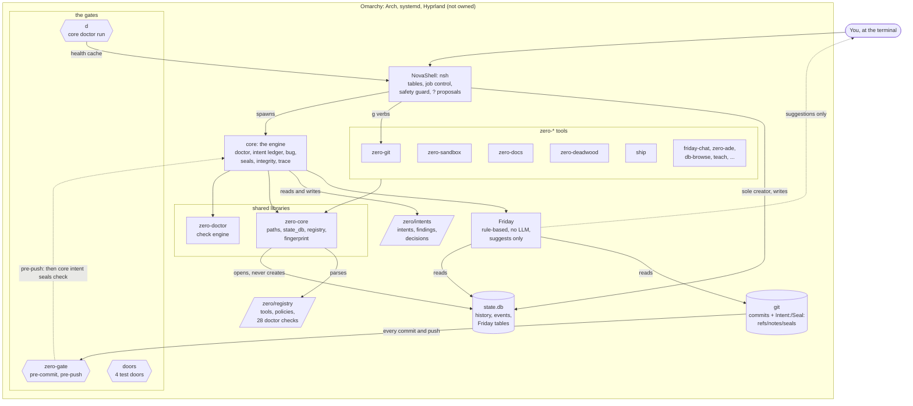
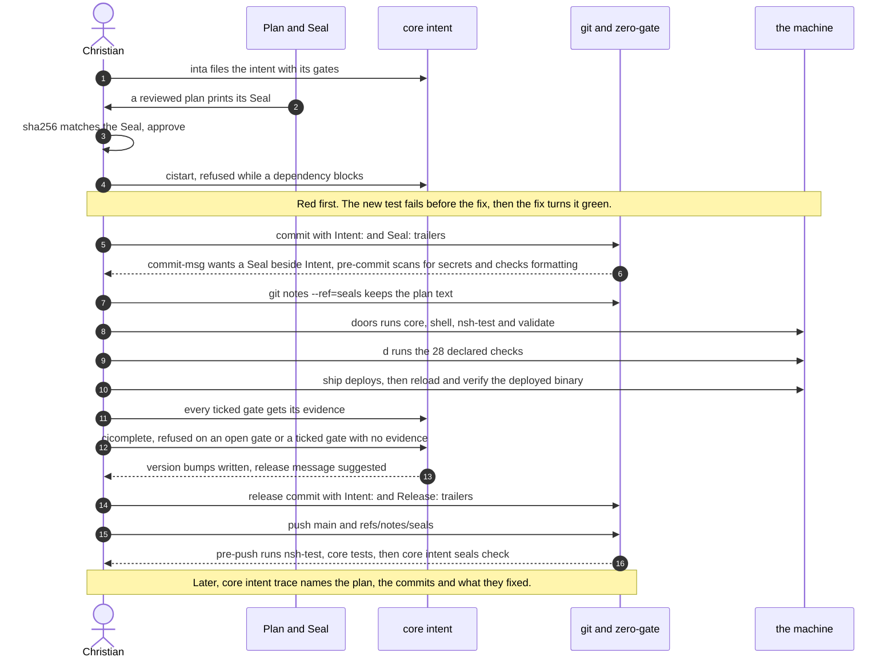

<p align="center">
  
</p>

<p align="center">
  <i>Omarchy is the base. Project 0 is only what is needed on top of it.</i>
</p>

<p align="center">
  
  
  
  
  
</p>

<p align="center">
  <a href="#see-it-run">See it run</a> ·
  <a href="#at-a-glance">At a glance</a> ·
  <a href="#what-it-looks-like">What it looks like</a> ·
  <a href="#how-it-fits-together">How it fits together</a> ·
  <a href="#quick-start">Quick start</a> ·
  <a href="#the-discipline">The discipline</a> ·
  <a href="#friday">Friday</a> ·
  <a href="#roadmap">Roadmap</a>
</p>

---

Project 0 is a personal Linux layer, written in Rust, that sits on top of
[Omarchy](https://omarchy.org) (Arch, systemd, Hyprland). It is built on one rule:

> **A tool that cannot answer must say so**, rather than report an answer it never established.

What that gets you:

- **NovaShell (`nsh`)**: a shell where commands return tables, pipelines filter values instead of
  re-parsing text, job control is its own, and a guard challenges destructive commands.
- **`core`**: one engine binary that holds the health check, the intent ledger, the bug report,
  integrity and the seals, and is home to **Friday**, a rule-based assistant with no LLM that
  only ever suggests.
- **A decision record**: every change of consequence is an *intent* with gates. Every ticked gate
  carries evidence, and every reviewed plan is sealed into git. `core intent trace` can tell you
  which plan produced a commit and what it fixed.
- **Gates that refuse to pass on nothing.** If a check can't run, it says UNDETERMINED or
  unknown. It never reports a green it didn't earn.

```
ps | where cpu > 1 | sort cpu desc | first 5      # tables through pipes
? show health                                    # plain words -> a proposed pipeline, run only on yes
```

---

## See it run

<p align="center">
  
</p>

<p align="center"><sub>
Recorded on Christian's laptop on 2026-11-15, right after the INT-319 push (commit <code>d2858903</code>).
Replayed with the time compressed: the real <code>nsh-test</code> door took 153.6&nbsp;s.
The banner's 96% is the health nsh had cached before that run; <code>d</code> then measured 100%.
</sub></p>

Three things happen here, and none of them is staged:

1. **The welcome banner** reads the ledger, git and the last test run. It shows 304/304 shell
   tests, 242 intents done, 2 blocked, and 70 open bugs, 2 of them high. Open bugs are on the
   banner on purpose.
2. **`doors`** runs the four test doors: the `core` tests, the shell tests, the real REPL driven
   through a pty by `nsh-test`, and `core intent validate`. *Four doors, and none of them ship.*
3. **`d`** runs the 28 declared health checks. Each one passes, warns, fails or says it can't tell,
   and the percentage names its basis: *28 of 28 determinable*.

<details>
<summary><b>Transcript as text</b> (the same session, to read or copy)</summary>

```text
  ◉ Project 0  Hyprland

  ━━━━━━━━━━━━━━━━━━━━━━━━━━━━━━━━━━━━━━━━━━━━━━━━━━━━━
  304/304  shell   96% ✅  health
  0 active  39 planned  242 done  · 2 blocked
  clean and pushed
  bugs: 70 open (2 high)
  ━━━━━━━━━━━━━━━━━━━━━━━━━━━━━━━━━━━━━━━━━━━━━━━━━━━━━

  "Not text streams. Not configuration. Structured wisdom."

  ↺ Strong streak. Project 0 is growing fast.
  Since last session: 13 new commits
  ↗ 133 commits this week — Project 0 is growing fast.

  help for commands  ·  q to exit

  ✓ config.nsh — 240 aliases  4 settings
    ~/0-core   main
  nsh❯ doors
doors
four doors, and none of them ship

  core       pass    0.2s  cargo test -p core
  shell      pass    4.3s  cargo test -p novashell -p nsh-test
  nsh-test   pass  153.6s  cargo build -p novashell -p nsh-test && NSH_BIN=/home/christian/0-core/target/debug/nsh /home/christian/0-core/target/debug/nsh-test
  validate   pass    0.0s  core intent validate

4 passed, 0 failed
d is its own door. Run d separately.
    ~/0-core   main  [158.4s]
  nsh❯ d

  ╭──────────────────────────────────────────────────────╮
  │  🏥 Project 0        HEALTHY  100%  │  28/28 checks  │
  ╰──────────────────────────────────────────────────────╯

  ╭─ 🖥  System
  │  ✅ Broken Symlinks         no broken symlinks found
  │  ✅ Binary Dependencies     all 12 binaries found
  │  ✅ Disk Space              3521.3 GB free -- 95% of the filesystem
  │  ✅ Fingerprint             this is the recorded machine and tree -- digest a56683c54812378b
  ╰─────────────────────────────────────────────────

  ╭─ 🌿 Git & Code
  │  ✅ Git Repository          working tree clean, all commits pushed
  │  ✅ Git Hooks               core.hooksPath is .githooks, hooks executable
  │  ✅ Rust Docs               cargo doc clean, 0 warnings
  │  ✅ Rust Toolchain          rust toolchain available
  ╰─────────────────────────────────────────────────

  ╭─ 📋 Internals
  │  ✅ Intent Ledger           All 93 intents valid
  │  ✅ Deadwood                0 low-priority items (stale .baks); no structural orphans
  │  ✅ Zero Config             all config files valid
  │  ✅ Zero Paths              5 directories, one name each -- no old name remains
  │  ✅ Schema Validation       4 registry files present, field checks clean
  │  ✅ Friday                  19 patterns · 1294 facts · 0.88 avg confidence
  ╰─────────────────────────────────────────────────

  ╭─ 🔒 Security
  │  ✅ Security Hardening      firewall on  sshd: key-only
  │  ✅ Security Audit          0 findings -- all upstream pending, none patchable (scanned today)
  │  ✅ Sandbox                 zero-sandbox deployed -- 7 policies active
  ╰─────────────────────────────────────────────────

  ╭─ 🛠  Tools
  │  ✅ Alias Coverage          all 13 tools have aliases (240 aliases total)
  │  ✅ Tool Installation       all 13 key tools installed
  │  ✅ Path Resilience         17/17 tools deployed (100%)
  ╰─────────────────────────────────────────────────

  ╭─ 🥾 Boot
  │  ✅ Boot Errors             no critical kernel errors since boot (5 low-priority notices)
  │  ✅ Boot Time               login ready in 1.576s (userspace)
  ╰─────────────────────────────────────────────────

  ╭─ 📦 System State
  │  ✅ Reboot Needed           running kernel 7.2.15-1-omarchy is the installed one
  │  ✅ Shell Handoff           marked line present; packaged handoff matches the canonical block; nsh is executable; nothing below it
  │  ✅ Package Cache           1374 cached packages, 6.3 GB
  │  ✅ Orphan Packages         no orphaned packages
  ╰─────────────────────────────────────────────────

  ╭─ 🖥  Runtime
  │  ✅ Network                 online -- DNS resolving
  │  ✅ VM State                no VMs running
  ╰─────────────────────────────────────────────────

  ━━━━━━━━━━━━━━━━━━━━━━━━━━━━━━━━━━━━━━━━━
  ✅ Passed:  28   ⚠️  Warnings: 0   ❌ Failed: 0   📊 Health: 100% (28 of 28 determinable)
  🔍 Integrity: 100%
➡️   Forecast  24h: 100%  7d: 100%  trend: stable  (last 10 runs: newest 3 vs the 7 before)
  💚  Stable — no concerns
```

The prompt's nerd-font icons are left out. Nothing else is changed.

</details>

---

## At a glance

*Measured at commit `d2858903` on 2026-11-15. These numbers are correct for that day and that commit.
Re-measure before you quote them.*

| | | source |
|---|---|---|
| NovaShell | `nsh` 6.0.1 | `zero/shell/novashell/Cargo.toml` |
| Engine | `core` 5.1.2 | `zero/engine/Cargo.toml` |
| Active tools | 17, plus 2 shared libraries | [zero/tools/README.md](zero/tools/README.md) (generated) |
| Rust | ~147,000 lines in 216 files | `wc -l` over `zero/**/*.rs` |
| Health checks | 28 declared, 28/28 passing | `zero/registry/doctor/checks.toml`, `d` |
| Shell unit tests | 278 | `cargo test -p novashell` |
| Pre-push doors | 4: core, shell, nsh-test, validate | [zero/scripts/doors](zero/scripts/doors) |
| Sandbox policies | 7 | `zero/registry/sandbox-policies.toml` |
| History | 5,445 commits since 2025-11-19 | `git log` |
| Intents done | 242, with 39 planned and 2 blocked | the nsh banner |
| Commits that name an intent | 806, by their `Intent:` trailer | `git log --grep` |
| Sealed commits | 279 carry a `Seal:` (the first on 2026-10-04), with 264 plan texts kept as notes | `git log --grep`, `refs/notes/seals` |
| Release commits | 15, by their `Release:` trailer | `git log --grep` |
| Findings | 111 filed, 31 commits carry a `Fixes:` trailer | `zero/intents/findings/`, `git log --grep` |
| Recorded decisions | 28 | `zero/intents/decisions/` |

---

## What it looks like

**Structured pipelines.** Builtins return tables, and the verbs work on values:

```
ps | where pgid == 1

  name     cpu  memory  pgid  pid  status  user
  systemd  0.0  0.0     1     1    Ss      root
```

| Verb | Does |
|---|---|
| `where field op value` | keep matching rows |
| `select a b` | keep columns |
| `sort field [desc]` | order rows |
| `first N` / `last N` | take rows |
| `count`, `get field`, `group field` | reduce and reshape |

Tables also pipe into ordinary tools and redirect to files: `ps | sort cpu desc | first 10 > top.txt`.

**Job control the shell owns.**

```
sleep 300
^Z
  ☸ [1] sleep -- suspended (fg 1 to resume)

jobs
  [1] stopped   sleep  (pgid 46310, 8s elapsed)

bg 1
  ▲ [1] sleep -- continued in the background
```

A pipeline is one job in one process group. Job state is *observed* per process, never inferred.
A job the shell can't account for shows `UNKNOWN` and the reason, instead of disappearing.

**Plain words, never run blind.** `? memory hogs` turns your words into a pipeline and shows it
with a confidence level. Nothing runs until you say yes. If it has no pattern, it says so.

**More of the same idea:**

```sh
fsearch "pub fn" --type rs | count       # search returns rows, not lines
signals | where handling != "default"    # what this process does with each signal
it                                       # the intent ledger as a two-pane TUI
```

### What it is not

`nsh` is **not POSIX** and doesn't pretend to be. It is **not the login shell**: `bash` keeps that
seat and hands off to `nsh` from `.bashrc`. A broken `nsh` build costs you one terminal tab, not
your session. If `nsh` hasn't modelled a construct, it hands the line to `sh` instead of guessing.

    POSIX shells   text  -> text   -> text
    Nu shell       table -> filter -> transform
    nsh            table -> filter -> judgment, and a refusal when it cannot answer

---

## How it fits together



<details>
<summary><b>The layers</b> (full version in <a href="docs/ARCHITECTURE.md">docs/ARCHITECTURE.md</a>)</summary>

| Layer | What | Where |
|---|---|---|
| 0, base | Omarchy: Arch, systemd, Hyprland. Someone else's good work, kept. | not in this repo |
| 1, engine | `core <domain> <command>`, one binary | `zero/engine/` |
| 2, declarations | TOML only: tools, aliases, profiles, zones, sandbox policies, doctor checks | `zero/registry/`, `zero/policy/`, `zero/schema/` |
| 3, tools | NovaShell, its test suite, the DevBox cases, and the `zero-*` tools | `zero/shell/`, `zero/tools/` |
| 4, state | the ledger database, config, cache. Outside the repo, under XDG `zero` dirs | `~/.local/state/zero/state.db` and friends |

</details>

**Three invariants hold it together.**

- **One owner per fact.** Every path is named once, in `zero-core`'s `paths.rs`, and the machine
  fingerprint is computed once, in `fingerprint.rs`. `state.db` has exactly one creator: NovaShell.
  Everything else opens it through `zero_core::state_db`, which never creates a file and says
  which of three ways the open failed.
- **Unknown is not success.** A missing health score prints as unknown, never as a number nobody
  measured. A sandbox that can't apply what its policy requires refuses to run.
- **Core never depends on intelligence.** Remove every AI component and the system still boots,
  runs and is usable.

---

## Quick start

> Written from [docs/WORKING-FROM-ANOTHER-MACHINE.md](docs/WORKING-FROM-ANOTHER-MACHINE.md), which
> says it has **not yet been run on a second machine**. Scope: Arch or Omarchy only.
> If a step fails, the doc is what gets fixed.

**Prerequisites:** `git` and `rustup` with the stable toolchain (`rustup default stable`). The
current lockfile needs rustc **1.88 or newer**.

```sh
# 1. Clone, and opt in to the tracked git hooks
git clone https://github.com/WidkidoneR2/0-Core ~/0-core
cd ~/0-core
git config core.hooksPath .githooks

# 2. Build the gate first. The hooks refuse every commit and push until zero-gate exists.
cargo build -p zero-gate

# 3. Build the shell, the engine, and the deployer
cargo build --release -p novashell        # binary: nsh
cargo build -p core
cargo build -p ship

# 4. Deploy (ship installs to ~/.local/bin and keeps a versioned backup)
ship nsh
```

> **Open, not yet tested:** how the newly built `ship` first reaches `PATH` on a machine that has
> never run it. Check that `ship` is on `PATH` before relying on step 4.

**Wire the shell.** bash stays the login shell and starts nsh from `.bashrc` via
[zero/shell/novashell/handoff/bashrc-handoff.sh](zero/shell/novashell/handoff/bashrc-handoff.sh).
Read it before you source it. It starts nsh only if `~/.local/bin/nsh` is executable, falls back to
bash if nsh crashes, and `touch ~/.config/nsh/off` turns the handoff off.

**Check it works.**

```sh
nsh-test          # drives the real REPL through a pty, and the -c door
core doctor run   # the health check (aliased to d)
```

---

## Daily commands

<details>
<summary><b>The aliases you'll type every day</b>, and what each one runs</summary>

Short names are aliases in `~/.config/nsh/config.nsh`. That file is the source of truth, and
`cheat` shows every alias live. The second column is what each one runs.

| You type | Runs | For |
|---|---|---|
| `d` | `core doctor run` | health, integrity and a verdict |
| `doors` | `zero/scripts/doors` | the four test doors: core, shell, nsh-test, validate |
| `nt` | `nsh-test` | the shell's regression suite |
| `intl` / `ints <id>` | `core intent list` / `show` | read the ledger |
| `inta` | `core intent add` | file a new intent |
| `cistart <id>` | `core intent start` | open an intent before writing code |
| `cicomplete <id>` | `core intent complete` | close it. Refuses while a gate is open or has no evidence |
| `it` | builtin | the ledger as a TUI |
| | `core intent next` | what to work on next |
| | `core intent trace <id>` | what an intent, finding, commit or seal found, fixed and produced |
| | `core intent seals check <range>` | every commit in a range carries an intact seal |
| | `core bug` | open findings: how bad, how old, how fast they get fixed |
| `ship` | `ship` | build release and deploy changed binaries |
| `reload` | builtin | restart into the newly deployed nsh |
| `fc` | `friday-chat` | talk to Friday |
| | `core friday status` | what Friday knows |
| | `core friday map` / `impact <path>` | the tool, crate and intent map, and what a file touches |
| `sb` | `zero-sandbox` | policy-checked runs, snapshots, diffs |
| `zg` | `zero-git` | risk-aware git status and verification |
| `devshell` | `zero/scripts/devshell` | a throwaway session for dangerous work. Nothing leaves unless promoted |

</details>

The full reference is in [docs/COMMAND-GUIDE.md](docs/COMMAND-GUIDE.md) and
[docs/NOVASHELL.md](docs/NOVASHELL.md).

---

## The discipline

Project 0 is built slowly on purpose. The rules are in [AGENTS.md](AGENTS.md), and the reasoning
behind them is in [docs/CONVENTIONS.md](docs/CONVENTIONS.md).

### The life of an intent

Every change of consequence takes this path. Each arrow is a real command or hook in this repo.




<details open>
<summary><b>The rules behind the diagram</b></summary>

- **Intents.** Every change of consequence starts as a file in [zero/intents/](zero/intents/)
  with a vision, the problem, the solution and its **gates**. The status line is the single
  source of truth for an intent's state.
- **Evidence.** A ticked gate is a promise, and its `evidence:` field is the receipt: a commit, a
  `file:line`, a log path, or "demonstrated: what and how". `cicomplete` refuses a ticked gate
  with an empty evidence field and writes nothing.
- **Seals.** Edits are made from a reviewed plan, and that plan prints a Seal. The commit carries
  `Intent:` and `Seal:` trailers, and the plan text is kept as a git note under `refs/notes/seals`.
  The pre-push hook runs `core intent seals check`, so a commit with a broken or missing seal
  doesn't leave the machine. Release commits are exempt, and the check says so.
- **Red first.** A behaviour is written as a failing test before the fix that turns it green. A
  gate you have only ever seen pass might be doing nothing.
- **Findings.** A problem found and not fixed is filed as `F-NNNN` in
  [zero/intents/findings/](zero/intents/findings/). Whether it's open is read from git
  (`Fixes:` trailers), never stored. `core bug` prints `unknown` and exits 3 when it can't answer.
- **zero-gate.** The tracked pre-commit hook scans for secrets (ripsecrets, then gitleaks) and
  checks formatting. Pre-push runs `nsh-test` and the core tests. A missing scanner fails the
  commit. See [.githooks/README.md](.githooks/README.md).
- **doors and d.** `doors` runs four test doors: core, shell, nsh-test, and `core intent validate`.
  `d` is its own door: the declared checks across system, git, internals, security, tools and
  boot. Each check reports one of three states, so a check that can't read its source never
  shows up as a pass.
- **A human decides.** Christian reads every plan, checks its Seal and approves it. AI assistants
  can draft plans, tests and patches. Nothing reaches `main` without his explicit approval.

</details>

---

## Friday

Friday is the assistant built into `core`. **No LLM and no embeddings:** she is rules, patterns and
facts, read from `state.db`, the ledger and git. **She suggests only, forever.** Nothing in Friday
runs a command, starts a daemon or adds a timer.

What exists today:

- `core friday status` and `friday-chat` (`fc`), a TUI that reads `state.db` and never invents.
- **Ground truth (INT-315, stage 1 of 6).** Commit counts come from git, habits come from the typed
  command record, and secrets are redacted before anything is stored. "Health unknown" replaces a
  hard-coded "Healthy."
- **Knows the machine (INT-316, stage 2 of 6).** One fact per doctor probe, with an expiry. pacman,
  Hyprland and systemd are treated as native. `core friday map` builds the tool, crate and intent
  tree from the repo and git history. `core friday impact` names the intents and tools a file touches.

The rulings for the remaining stages are recorded in INT-315: learning on each `d` and
`core friday` call with no daemon, explicit and implicit feedback, a 30-day habit half-life, and
no desktop popups.

---

## Roadmap

Direction, not promises. Each item becomes an intent with gates before any code is written.

| | What | Built on |
|---|---|---|
| **NFlow** | Typed, inspectable pipelines. A pipeline is type-checked before any stage runs, and a mismatch is rejected up front, not halfway through. You can see what each stage takes and gives. | nsh's existing value pipeline (`where`, `sort`, `first`, `group`, `map`, `reduce`) |
| **Devbox worlds** | Named, clonable, diffable worlds: `world create`, `clone`, `run`, `diff`. Each world has a toolchain, a secrets policy (default: none) and resource limits. Every result is PASS, FAIL or UNDETERMINED, never a silent success. | `zero-sandbox`'s namespaces, seccomp, cgroups, reflink snapshots, and the DevBox cases in `zero/shell/devbox/` |
| **The NovaShell map** | A real, generated map of how nsh, `core`, the tools, the registry, `state.db` and the gates call and depend on each other, with the map checked against the code. | `core friday map` / `impact`, `zero/registry/tools.toml`, the workspace graph |
| **Friday, independent** | A personal assistant that needs no outside AI: stages 3 to 6 of the INT-315 path, learning only from this machine. | Friday's tables in `state.db`, the ledger, git |
| **Ledger and tool upkeep** | Finished intents removed from `zero/intents/open/` when `cicomplete` runs (git keeps them), bug batches, and a tool-by-tool modernization pass. | `core intent`, `core bug`, `zero-deadwood` |

---

## Origin

Project 0 began in August 2026. The machine was wiped and reinstalled on Omarchy, and the real
question became what to carry over. **The answer was: less than expected.** Checks that couldn't
fail, counts that disagreed with each other, and tools whose purpose had left with the old platform
were retired, each with a recorded reason.

What came before was not a failure. It was more projects than one person could keep honest. Project 0
is the same person with a shorter list. The principle hasn't moved: build it from parts you
understand, or don't run it at all.

**The thesis: a shell can know what it did.** That means known, not just logged: which session, which
command, what it exited with, what you ran next. `nsh` keeps that record for every command it runs, and the
tool inventory in [docs/inventory.md](docs/inventory.md) was decided from it rather than from memory.

## Philosophy

1. **Understanding over convenience.** If you don't understand it, it doesn't run.
2. **Manual control over automation.** Nothing happens without explicit authorization.
3. **Intentional design.** Every tool has a purpose, and every decision has a record.
4. **Project 0 remembers.** Every commit, decision and intent is documented and learned from.

Rust, not for its own sake: Rust because understanding every line is the point. "No bloat" doesn't
mean writing everything ourselves. If a proven Linux component does exactly the job, it gets used.

## Security

- Firewall on and sshd key-only, both checked on every `d` run.
- `zero-sandbox`: a policy engine with namespace isolation. It refuses a run whose required controls
  can't be applied.
- `devshell`: dangerous work happens in a session where writes are thrown away unless promoted by
  name, and there is no network, no credentials and no host processes.
- Secrets are never committed. Every commit is scanned by ripsecrets and gitleaks, and a missing
  scanner fails it.
- `cargo-audit` findings are triaged in the open, each with a written reason.
- Secure Boot is **not** enforcing, and this README doesn't claim it is.

## Going deeper

- [Architecture](docs/ARCHITECTURE.md): how the pieces fit
- [NovaShell](docs/NOVASHELL.md): the shell, verb by verb
- [Shell philosophy](docs/NSH-PHILOSOPHY.md): the case for a human-first shell
- [Philosophy](docs/PHILOSOPHY.md): why it is built this way
- [Conventions](docs/CONVENTIONS.md): the reasoning behind the rules
- [Fingerprint](docs/FINGERPRINT.md): how the machine knows it is itself
- [The tree](docs/TREE.md): where every file goes
- [Tool catalog](zero/tools/README.md): every active tool, generated from source
- [Inventory](docs/inventory.md): what is used, what is kept, and what the numbers say
- [Command guide](docs/COMMAND-GUIDE.md): the commands you reach for daily
- [Changelog](zero/meta/CHANGELOG.md): the full history, Arch era to Omarchy
- [Working from another machine](docs/WORKING-FROM-ANOTHER-MACHINE.md): clone, build and wire a second machine
- [Agent contract](AGENTS.md): the rules every contributor, human or AI, works under

## License

MIT. See [LICENSE](LICENSE). Use it, learn from it, build on it.

---

<p align="center"><i>Every tool written or fully understood. Nothing runs blindly.</i></p>
